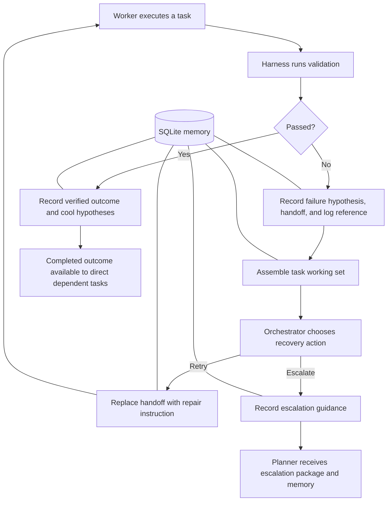

# MobyAI Agentic Memory: Design, Operation, and Practical Limits

**Report date:** September 24, 2026  
**Implementation reviewed:** repository revision `76fb033`  
**Scope:** MobyAI's project-memory records, retrieval, agent integration, persistence, and operating constraints.

## Overview

MobyAI's agentic memory is a persistent project notebook controlled by the Python harness. It stores selected information about failed attempts, repair instructions, escalations, and successful task completion. Before an agent receives a request, Moby can retrieve a small, relevant portion of that notebook and include it in the request.

The purpose is continuity. A Worker attempting a repair should have access to useful information from the previous attempt. An Orchestrator deciding what happens next should see the current recovery state. A Planner receiving an escalation should receive relevant history without needing the entire conversation. A later task can also receive verified outcomes from tasks it directly depends on.

This memory does not modify model weights, train a model, or make all previous experience permanently available to it. Information affects an agent only when the application supplies it in the current request. The harness remains responsible for task state, tool execution, test validation, and memory writes.

The implementation uses the existing Python process and SQLite database. It requires no additional model or embedding service. Its main tradeoff is selecting enough useful history to improve continuity while preserving prompt space for the current task and source files.

## 1. What “agentic memory” means in this system

A model request has a finite context: the text available to the model while it produces a response. An agent may make several requests while editing files, attempting repairs, or coordinating with another agent. The next request does not automatically contain everything from previous requests.

Moby separates two things:

| Component | Purpose | Lifetime |
| --- | --- | --- |
| Persistent memory | Stores task-related records and their relationships | Survives process restarts in SQLite |
| Working set | Supplies selected, shortened records to an agent | Assembled for a particular request or handoff |

A useful analogy is a project notebook and a briefing prepared from it. The notebook contains more detail than the briefing. The briefing includes only what the application selects and can fit into the available space.

Memory complements Moby's existing task contracts, checkpoints, events, module contracts, and test logs. It does not replace those systems. For example, a log remains the detailed record of test output; memory stores a pointer to it and selected recovery information.

## 2. Who owns and consumes memory

The harness writes memory at defined boundaries. The models do not currently have a general-purpose tool for creating, revising, or deleting memory nodes themselves.

| Participant | Relationship to memory |
| --- | --- |
| Worker | Receives a working set alongside its task contract, reduced errors, remediation instruction, and selected files |
| Orchestrator | Receives task memory when deciding how to handle validation failure |
| Planner | Receives a memory block in the escalation package used for replanning |
| Python harness | Records attempts and handoffs, creates outcomes after validation, selects entries, and enforces memory budgets |
| SQLite store | Persists entries and relationships and supports full-text search |

The agents therefore share application-managed information rather than a continuously shared model context. Each role receives the block at its own integration point. The Planner integration described here is the escalation/replanning path, not universal memory injection into every planning request.



The diagram summarizes memory flow. Moby's broader orchestration rules still determine whether work retries, escalates, pauses, or completes.

## 3. What Moby records

Each memory node has a unique ID, project ID, task ID, type, layer, name, body, creation timestamp, and optional retraction timestamp. A hypothesis can also carry a failure fingerprint.

The node's **type** describes what it means. Its **layer** describes how it is treated when preparing a prompt.

| Node type | Recorded content | Interpretation |
| --- | --- | --- |
| Hypothesis | Failure signature, instruction used, harness error, and file fingerprints | A record of a failed attempt and its guidance; not a proven root-cause diagnosis |
| Handoff | Latest failure summary, retry instruction, or escalation summary | Current direction for continuing the task |
| Claim | Repair instruction or summary recorded during escalation | Proposed guidance that may coexist with different guidance |
| Outcome | Explicit harness pass, attempt number, task name, validation commands, and target files | Evidence that the task satisfied harness validation at that time |
| Artifact reference | Attempt number and test-log path | A reference to supporting evidence stored elsewhere |

Memory does not systematically copy full source files, full test logs, or the whole conversation. Error and instruction text can still contain excerpts of those materials. File fingerprints record content identity, not a readable copy of the file.

## 4. How the four layers work

The layers control prompt detail rather than separate storage hardware. All node layers are stored in the same memory repository.

| Layer | Rendering behavior | Typical assignment |
| --- | --- | --- |
| Core | Includes the body, capped by default at 400 estimated tokens per current-task node | Successful outcomes |
| Hot | Flattens the body to a single line and limits it to 240 characters | Handoffs, hypotheses, and claims |
| Warm | Includes the node's type and name, without its body | Artifact references |
| Cold | Excluded from automatic working-set assembly | Hypotheses for tasks that have passed |

These layers are assigned by explicit rules. There is no general learning algorithm that promotes frequently used memories or automatically ages unused records into colder layers.

Within a task, assembly orders core before hot before warm. Within each layer, it prioritizes outcomes, handoffs, claims, hypotheses, and artifact references. Timestamps and node IDs provide deterministic ordering; this is not a semantic relevance score, and older entries of the same layer and type sort first.

An entry can exist in the database without its details appearing in a prompt. A warm artifact reference, for example, exposes its name but not its stored log-path body through this renderer. Detailed logs may be supplied through other context mechanisms.

## 5. The memory lifecycle

### A failed attempt

After execution and validation, the harness creates an artifact reference for the attempt. On failure it also records a hypothesis containing the attempted instruction, error, failure signature, and file fingerprints. A `derived_from` relationship connects the hypothesis to the artifact reference. A handoff records that the attempt failed.

The memory fingerprint hashes normalized harness-error text together with the task's validation commands. Normalization reduces differences caused by case, whitespace, recognized task identifiers, and certain timestamp strings. Both recording and failure-time prompt selection use the persisted harness error, avoiding mismatches caused by hashing a short error on one side and a rendered log on the other.

This is exact matching over normalized input. It does not understand whether two error messages represent the same underlying bug. Different bugs producing the same short harness error and commands can share a signature.

### A retry

When the Orchestrator requests another attempt, the harness replaces the live handoff with the retry instruction. The old handoff is retracted and linked from its replacement. On the next worker-context build, relevant memory is assembled again from persisted state.

A new hypothesis with an existing failure fingerprint supersedes the older hypothesis for that fingerprint. Hypotheses with other fingerprints remain stored. When a failure signature is supplied to assembly, mismatched hypotheses are excluded from the working set. Without a supplied signature, that particular filter is not applied.

### An escalation

When a task moves to the Planner, the harness records an escalation handoff and, when guidance is available, a repair claim. It assembles the memory block and includes it in the escalation package.

Claims with matching names and equivalent bodies are reused. If the body differs, both claims remain live and a `contradicts` relationship is recorded. Here, “contradicts” means different text under the same claim name; the implementation does not establish that the claims are logically incompatible.

### A successful attempt

After the harness confirms success, memory records an explicit outcome. It does not relabel the prior failure message as a successful result. The outcome describes the passed task, attempt, validation commands, and target files, and links to the successful attempt's artifact reference.

The active handoff is retracted and retained as provenance. Live hypotheses for the task become cold. Any older live outcome for the same task is superseded. Repair claims are not automatically retracted by this success operation.

“Verified” has a specific scope: the harness's validation conditions passed. It does not prove that the software has no bugs or that the model's explanation of the repair was correct.

## 6. Provenance and historical records

The memory graph stores three relationship types:

| Relationship | Meaning in the implementation |
| --- | --- |
| `derived_from` | Connects a record to supporting or preceding records |
| `supersedes` | Connects a replacement to the earlier record it replaces |
| `contradicts` | Connects differing claims sharing a claim name |

Retraction and cooling have different meanings. A retracted record is no longer live. A cold record may still be live but is excluded from automatic prompt assembly. Neither operation deletes the row.

The graph preserves a history that application code can inspect. Current prompt assembly reads nodes, not graph edges, and does not automatically traverse provenance chains or resolve contradictions. Full-text search excludes retracted nodes but can return cold ones, because its filtering rules differ from automatic assembly.

## 7. Recall within and across tasks

Automatic recall starts with live records for the current project and task. It filters out cold and retracted records, optionally filters hypotheses by failure signature, and renders the remainder within a budget.

For cross-task recall, the implementation checks at most the first eight direct dependencies in the task's dependency list. A dependency contributes only when its current task status is `passed` and it has a live core outcome. The latest such outcome is selected for each eligible dependency.

Dependency outcomes receive at most one quarter of the memory budget, capped at 500 estimated tokens. Their rendered block is accounted for before assigning the remaining budget to current-task memory. The final output places current-task memory first, followed by completed dependency outcomes. Unused dependency allowance remains available to current-task memory.

This is controlled reuse within a project. It does not automatically search unrelated tasks, traverse all transitive dependencies, transfer memories between projects, or preserve all relevant history when a Planner replaces a task with a new task ID.

There is also a separate `recall()` helper backed by repository search. SQLite FTS5 searches node names and bodies using quoted terms joined with OR. It uses up to 12 extracted ASCII alphanumeric/underscore terms. Project and optional task filters apply before the result limit, and results are ordered by timestamp and node ID rather than relevance rank. The default helper limit is 10 results.

That search helper is available to application code. It is not currently an agent-facing search tool or the automatic working-set retrieval path. Moby's separate research/vector-cache features should not be confused with this project-memory implementation.

## 8. Context budgets and resource costs

The default configuration is:

```yaml
context:
  worker_token_budget: 48000
  memory_token_budget: 2000
```

The memory allowance is included within the Worker's context budget. It is not an extra 2,000 tokens added after a 48,000-token context has already been filled.

The packer first accounts for task instructions, contracts, and other core evidence, including its existing evidence-shrinking rules. It then reserves the available memory space and packs source files into the remainder. It can shorten the memory block further to fit. The final context token count includes memory.

During memory assembly, entries that do not fit are skipped. An omission notice is included only if it also fits; a shorter count may replace a list of names. An individual large entry may be omitted even though some space remains. Storage size and prompt size are therefore separate concerns.

At the defaults, dependency outcomes can use up to 500 estimated tokens of the 2,000-token memory allowance. If they actually render to less than that, current-task entries can use the remainder, allowing for a separator. These figures are ceilings, not promises that a particular record will be included.

Moby estimates tokens using approximately one token per four characters. This bounds the rendered worker-context object according to that estimator; it is not an exact tokenizer count or a guarantee about the entire model request, which can also contain other messages. The Orchestrator and Planner receive a bounded memory block alongside their other prompt content.

Storage, hashing, and retrieval use CPU, RAM, and disk. No additional inference model, embedding process, or dedicated GPU allocation is introduced. Included memory still requires prompt processing by the configured model. Lower budgets reduce available memory detail; the configuration currently requires a positive value and has no separate memory-disable switch.

## 9. A concrete example

Consider an illustrative project with two tasks: create an API module, then build a client that depends on it.

| Stage | What is stored | What the next agent can receive |
| --- | --- | --- |
| API attempt 1 fails validation | Failed-attempt hypothesis, failure handoff, file fingerprints, and log reference | Selected failure memory plus the task's existing context |
| Orchestrator requests a repair | New retry handoff superseding the failure handoff | Current repair direction and matching hypothesis |
| API attempt 2 passes | Explicit core outcome; hypotheses cooled; handoff retracted | A verified completion record for downstream use |
| Client task begins | Existing API outcome is retrieved as a direct dependency | A bounded description of the completed API task, not its old repair guesses |

An illustrative outcome body is:

```text
STEP_001 passed harness validation on attempt 2.
Task: Implement the API module
Validated commands: ["pytest tests/test_api.py -q"]
Target files: ["src/api.py"]
```

This record tells the client task what work passed and which validation was used. It does not contain the API's complete interface. The client still needs applicable source files or module contracts to implement the integration correctly.

## 10. Persistence, restart behavior, and data handling

The production memory repository uses the existing state database configured by `persistence.database_path`; the reference default is `~/MobyAI/mobyai.db`. Schema migration 3 adds `memory_nodes`, `memory_edges`, an FTS5 search table, supporting indexes, and triggers that maintain the search index when nodes change.

On restart, working sets can be reconstructed from persisted task and memory records. Persistence does not require preserving the model's internal state. Existing projects accumulate memory as subsequent attempts execute; the implementation does not automatically backfill all older attempts.

The in-memory repository used in tests provides the same interface but has no durability across process exits. Its search is a simpler substring approximation, so it should not be treated as an exact reproduction of FTS tokenization.

Project deletion removes the project's memory edges and nodes along with its other saved state. There is no automatic age-based expiry or compaction policy. Retraction and cold storage reduce prompt exposure but do not stop database growth. Full logs remain separate workspace artifacts.

Memory may contain project paths, error messages, model-proposed repair guidance, and file fingerprints. Persistence is local, but the selected working set is sent to the configured inference endpoint as prompt content. Consequently, an external inference endpoint can receive selected memory text. File fingerprints are limited to the first 50 sorted unique task paths, with files larger than 2,000,000 bytes marked too large to fingerprint.

## 11. Benefits, limits, and evidence

The implementation provides a concrete mechanism for preserving recovery context, handing information between roles, and reusing completed dependency outcomes. These capabilities should reduce the need to reconstruct task history from scratch. They do not by themselves demonstrate a measured increase in coding success rate or a reduction in inference cost.

Important limits are:

| Limit | Practical consequence |
| --- | --- |
| Short harness errors can share a fingerprint | Different underlying failures may be grouped together |
| Hot entries are clipped to 240 characters | Detailed instructions or file fingerprints may be stored but absent from the briefing |
| Graph edges are not rendered or reasoned over | Provenance is retained, but contradiction resolution remains unimplemented |
| Outcomes describe a historical validation pass | Later file changes can make an outcome stale; memory recall does not revalidate it |
| Cross-task recall is restricted to direct completed dependencies | Useful unrelated or replanned-task history may not reach an agent |
| Cooling does not delete records or automatically close claims | Storage can grow and some guidance remains live after success |
| Graph updates use multiple repository operations | The whole replacement sequence is not one atomic transaction; interrupted writes or concurrent writers merit additional hardening |

Tests in `tests/unit/test_memory_layer.py` cover supersession, claims, successful outcomes, budgets, scoped search, dependency recall, agent integration, and SQLite reopening. The implementation work preceding this report recorded **552 passing tests and one skipped test** across the unit and integration suite, plus successful local configuration validation and SQLite FTS5 availability checks. Those are prior validation results, not a new test run for this report. No live GPU-backed coding run or comparative memory-quality benchmark was performed as part of that validation.

For future evaluation, useful measurements would include success rate on repeatable repair tasks with and without memory, repeated ineffective instructions, prompt-token consumption, retrieval of relevant evidence, and database growth over long projects. These would establish effectiveness beyond functional correctness.

## 12. Implementation references

The following repository files are the primary sources for this report:

| File | Responsibility |
| --- | --- |
| [Memory models](../src/mobyai/models/memory.py) | Node types, layers, relationships, and fields |
| [Boundary recording](../src/mobyai/memory/record.py) | Attempt, retry, and escalation records |
| [Graph rules](../src/mobyai/memory/graph.py) | Supersession, retraction, claims, and successful outcomes |
| [Working-set assembly](../src/mobyai/memory/assembly.py) | Filtering, ordering, rendering, budgets, and dependency outcomes |
| [Recall helper](../src/mobyai/memory/recall.py) | Project- and task-scoped search entry point |
| [Context packer](../src/mobyai/context/packer.py) | Worker memory integration and context accounting |
| [Worker execution](../src/mobyai/engine/working.py) | Recording after attempt validation |
| [Orchestration](../src/mobyai/engine/orchestration.py) | Failure recovery and escalation integration |
| [Recovery evidence](../src/mobyai/engine/recovery_evidence.py) | Failure normalization and file fingerprints; related repeated-instruction safeguards |
| [SQLite repository](../src/mobyai/state/sqlite.py) | Persistent operations, search, and project deletion |
| [Database migrations](../src/mobyai/state/migrations.py) | Memory schema and FTS index maintenance |
| [Memory tests](../tests/unit/test_memory_layer.py) | Regression coverage for the implemented behavior |
