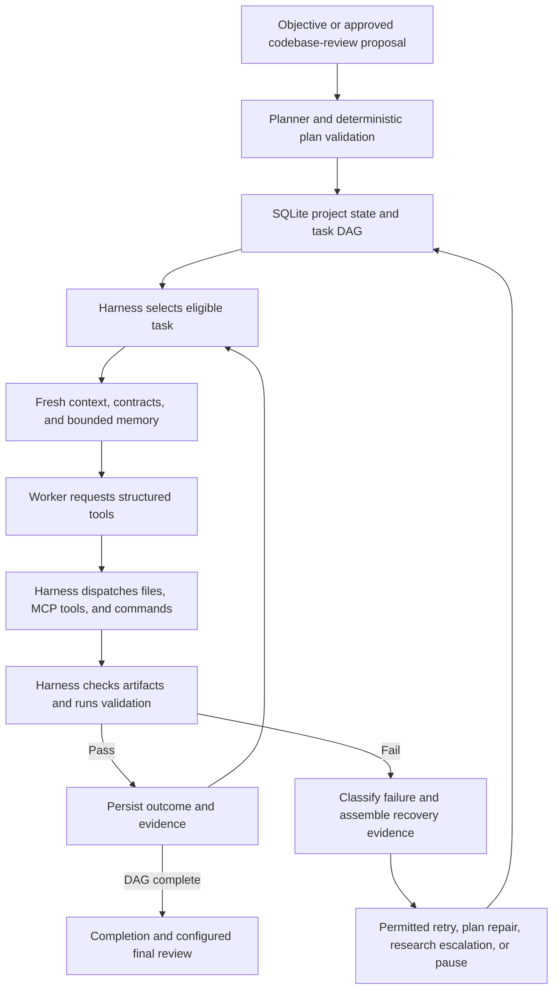

# MobyAI: project chronology and architectural evolution

This is a reading guide to every commit visible in the local repository as of October 2, 2026. The implementation snapshot is `main` at [`9ef2314`](https://github.com/mettetsystems/moby-ai-assistent/commit/9ef23148e52338c40124d456cfde692f512cfbd9).

**The central finding:** Moby began as a deterministic, resumable coding workflow wrapped around three model roles. That design survives. Most subsequent development added the machinery needed to operate it on real hardware and real projects: installation, diagnosis, context freshness, review, memory, isolation, and evidence. The largest change is how much the application now knows about failures before asking a model to repair them.

## What “the original design” means here

The literal initial commit contains only a one-line README. The useful architectural baseline is the next commit, `ae4476a`, which introduces the entire Phase 1–12 implementation together. Git therefore cannot reconstruct twelve separate development phases: their sequence is described in the committed implementation plan, rather than represented by twelve commits.

The original master specification, `docs/build-plan.md`, is gitignored and absent from this checkout. This comparison uses the [first committed implementation plan](https://github.com/mettetsystems/moby-ai-assistent/blob/ae4476a1098ea3a6b0b2837172700395fc0b583b/docs/implementation-plan.md), its implementation notes, and the actual code. It cannot establish every difference from that unavailable prompt.

There are **22 commits across the available refs, of which 21 are ancestors of current `main`**. One October commit is an alternative line of work, explained below. Dates below are author dates in Eastern time. An August 31 change entered `main` through a September 11 merge; its position by date does not mean it was already present in the intervening main-line commits.

For “why,” this report distinguishes **documented reasons** in commit messages, notes, and regression evidence from **inferences** about the broader motivation. A diff establishes what changed; it does not, by itself, establish what someone was thinking. No live model runs or performance benchmarks were performed for this history.

## The starting architecture

The first implementation was already much more than a chatbot:

1. The **Planner** proposed atomic tasks, files, acceptance criteria, test commands, and dependencies as a directed acyclic graph (DAG).
2. The **Python harness** validated that plan, persisted it to SQLite, and selected eligible tasks.
3. The **Worker** received a bounded task briefing and requested structured file or command operations.
4. The **harness ran validation**. A worker saying `done` was insufficient: required artifacts and successful test execution determined whether a task passed.
5. The **Orchestrator** supplied repair guidance within application-owned retry rules. A second failure normally escalated to the Planner, which replaced the failed branch while preserving passed tasks.
6. Pause and resume reconstructed the project from durable state, rather than asking a model to remember the conversation.

The models used OpenAI-compatible HTTP endpoints. Planner and Worker could share a GPU over time; the application managed process isolation and model swapping. SQLite, a small Python dependency set, a CLI, and scripted model fixtures kept the initial system local and testable without GPUs.

Several capabilities that might look like later additions were present immediately: schema validation, bounded worker turns, token-budgeted context, filesystem path checks, command timeouts, test-owned success, checkpoints, and targeted replanning. Conversely, the original filesystem jail was not an operating-system sandbox for arbitrary subprocesses.

## Chronology: every commit

### August 26 — 1. Repository creation

[`8159cff` — Initial commit](https://github.com/mettetsystems/moby-ai-assistent/commit/8159cff8d5075aee5f2958644dd3776c7da7b107)

**Delta:** A README containing the project name. No application, configuration, tests, or architecture.

**Why:** Repository initialization. Treating this as a working platform would obscure the actual baseline.

### August 27 — 2. The complete initial harness

[`ae4476a` — Add MobyAI harness through Phase 12.](https://github.com/mettetsystems/moby-ai-assistent/commit/ae4476a1098ea3a6b0b2837172700395fc0b583b)

**Delta:** The three roles, deterministic state machine, DAG scheduling and patching, SQLite persistence, bounded context, file/command tools, inference client, GPU service manager, CLI, and end-to-end fixture arrive together.

**Why, documented:** Build a single-user, local-first workflow in which models supply intelligence but Python owns state and execution truth. The fixture exercises retry, escalation, branch replacement, and resume without depending on live model behavior.

The plan also records an early correction to the specification diagram: retry returns to dispatch so the Worker actually runs again. Deterministic corrections to model workflow were part of the design from the start.

### August 27 — 3. Make first-run setup explicit

[`3556566` — Add an explicit first-run setup walkthrough.](https://github.com/mettetsystems/moby-ai-assistent/commit/3556566567e66354ff08a7984875214b2284ad72)

**Delta:** `scripts/setup.sh`, `mobyai setup`, and a detailed setup guide explain and generate the environment and configuration. Bash handles the interpreter/venv/install steps; Python handles validated YAML.

**Why, documented:** Operators previously had to infer configuration search order and installation steps. The commit explicitly replaces implied setup with a paused walkthrough and written next steps.

This concerns **Moby's own application environment**. Later worker-created project venvs are a separate issue.

### August 28 — 4. Add an operator console

[`e8389f0` — Add an operator console for live sampling and DAG traces, with setup defaults for models and Hugging Face token.](https://github.com/mettetsystems/moby-ai-assistent/commit/e8389f02f14b9923aa05fcf43cc9132998ee4579)

**Delta:** A browser console provides Settings and Monitor, live decoding controls, and execution visibility. Configuration overlays preserve the base YAML. Setup becomes more opinionated about model choices and token provisioning.

**Why, documented:** Humans need to inspect execution and change inference settings without editing configuration by hand or relying on a model's account of its own state.

**Architectural effect:** Moby begins acquiring an operator-facing product layer over the existing engine. The browser does not become the authority for task success.

### August 28 — 5. Provision inference, not just Python

[`9e10263` — Provision llama.cpp during setup and reuse live endpoints on start.](https://github.com/mettetsystems/moby-ai-assistent/commit/9e10263e05983872814e13e9972a4749c055b549)

**Delta:** Setup can install llama.cpp, obtain model files, and check endpoints. Starting a role can reuse an already healthy endpoint instead of creating a duplicate server.

**Why, documented:** Installing the Python package alone did not produce a usable local inference stack. Provisioning and endpoint reuse make the first run practical while retaining the OpenAI-compatible provider boundary.

### August 31 — 6. Keep context bounded as projects grow

[`bb1ffd0` — Keep long-horizon prompts bounded with jailed tools and harness-owned contracts.](https://github.com/mettetsystems/moby-ai-assistent/commit/bb1ffd0cb71b258e027c6a4d3d3a012d2bad0d17)

**Delta:** Workers gain bounded range reads and globbing; the Planner gains read-only inspection through the dispatcher. After validation passes, Python extracts module interfaces and stores them in SQLite. Context can include relevant signatures instead of entire neighboring files. Managed launches receive role-specific context sizes.

**Why, documented:** Long projects cannot keep copying growing source trees into prompts. Interface contracts and targeted inspection provide useful evidence within a budget.

**History detail:** This work joins the active line through the September 11 merge. It was developed in parallel with the next two changes.

### September 9 — 7. Adapt setup to actual hardware

[`3b3c13f` — updated mobyai](https://github.com/mettetsystems/moby-ai-assistent/commit/3b3c13fb012465b94991c06a971935622336f630)

**Delta:** GPU detection, device selection, runtime directories, installation behavior, and startup diagnostics become more robust. The code distinguishes CUDA-capable runtime provisioning from unsuitable backend builds, aligns GPU enumeration, and reports early server exits and logs.

**Why:** The title supplies little rationale. The added checks and comments show the technical problems being addressed: wrong GPU selection, incompatible inference builds, and difficult-to-diagnose startup failures. It is an **inference** that this bundle reflects bringing the original reference setup onto the actual operator machine; a specific triggering run is not documented by the commit message.

### September 11 — 8. Separate launching from installing; strengthen context evidence

[`6dc22a2` — updated readme](https://github.com/mettetsystems/moby-ai-assistent/commit/6dc22a26ab69c24259fe45162cf36e6669739994)

**Delta:** Much more than a README edit: a normal `scripts/start.sh` launch path, stronger dependency evidence in task context, explicit handling when required context cannot fit, better failure provenance and endpoint errors, and console improvements.

**Why, documented in the accompanying behavior and guidance:** An ordinary launch should not repeat installation. A worker briefing must retain required tests, constraints, and relevant failure information instead of silently dropping them when space runs out.

**Practical effect:** Context budgeting becomes a correctness concern, not merely a token-saving feature. The budget still covers the packed context, not a guarantee that the entire system prompt, schema, and accumulated tool conversation fit the backend window.

### September 11 — 9. Reconcile the parallel context work

[`19d8f92` — Merge remote main and reconcile contracts, retrieval, and setup](https://github.com/mettetsystems/moby-ai-assistent/commit/19d8f923a47fe696d1ac8676661fe602d28f05c4)

**Delta:** Merges `bb1ffd0` with the hardware/setup/context line. Reconciles module summaries with dependency evidence, source freshness, Python calling conventions, bounded reads and listings, and runtime configuration.

**Why, documented:** Both approaches must preserve useful information: a compact signature is unsafe if stale or if it loses positional-only/keyword-only distinctions. The merge integrates the two implementations rather than simply choosing one.

The commit reports 283 passing tests and shell syntax validation. That is historical validation reported by the author, not a fresh result from this review.

### September 12 — 10. Expand into an operational application

[`e5cf6f6` — Implement application updates and supporting improvements](https://github.com/mettetsystems/moby-ai-assistent/commit/e5cf6f6eab15cc55934c1a8f0bb4f1a1b47bea6d)

**Delta:** This broad commit substantially expands both the console and recovery behavior:

- Import objectives and launch workloads from the console; choose and relocate workspaces; distinguish resume, restart, and deletion of project state.
- Manage workload processes, locks, cancellation, resumable pause, elapsed time, restart, and temporary keep-awake behavior.
- Classify failures so local coding errors are treated differently from network, access, toolchain, and context failures.
- Add bounded transport retries and staged recovery sampling for eligible failures.
- Add a local research cache, fixed MCP research integration, and optional MLflow tracing.
- Remove the default whole-project step/replan ceiling while retaining bounds on individual attempts and schema repair.

**Why, documented across the added guidance:** A long-running project needs lifecycle controls and recovery appropriate to the actual failure. Changing temperature cannot repair inaccessible infrastructure. Stopping merely because a project crossed a generic replan count can abandon otherwise recoverable work.

Research also has a controlled escalation path: normal workers and initial planning use local lookup; outbound research is reserved for an explicitly authorized recovery path after local attempts and cache recovery. The cache uses CPU lexical retrieval, not a new neural embedding service.

**Tradeoff:** The system becomes more persistent, but unlimited project-level replanning is not a convergence guarantee. The overall interpretation—moving from an MVP to an operator application—is an inference from the breadth of the changes, not the generic commit title.

### September 13 — 11. Fix an observed missing-Jest failure

[`e69d0dd` — final](https://github.com/mettetsystems/moby-ai-assistent/commit/e69d0ddfc70e8f5b3f9f5ec293b28685f1125c8c)

**Delta:** Commands can resolve project-local Node executables, including nested project locations within the workspace. Missing npm executables receive a specific locally repairable diagnostic without sampling escalation. Monitor presentation also improves.

**Why, explicitly documented:** The implementation notes describe a FlowBPM task whose saved Jest command exited 127. Jest was declared in `package.json`, but its local executable was absent. Installing the declared development dependencies made the unchanged check pass, including 21 theme tests.

This is a concrete example of why “the code failed” is too coarse: the environment was incomplete. The title `final` does not mark the end of development or a demonstrated production-ready release.

### September 14 — 12. Support existing codebases and explain decisions

[`6fe6aa4` — Add codebase review workflows and logic reports](https://github.com/mettetsystems/moby-ai-assistent/commit/6fe6aa4f365ece6acd7214573685b35422b703a0)

**Delta:** Adds review workflows for both Moby-created projects and unfamiliar repositories. Native projects can use recorded plans and outcomes; foreign repositories get bounded static archaeology, search, and relationship evidence. Reviews produce proposals subject to operator approval and source-fingerprint freshness checks.

`mobyMinutes` archives project reasoning evidence and outcomes, and logic reports explain the project's trajectory. Review roles reuse the Planner model; they do not require another permanently resident GPU model. A graceful shutdown helper is added too.

**Why, documented:** Continuing an existing codebase requires understanding its structure and preserving its intent. Proposed changes must remain reviewable, and an approval must not silently apply after the source has changed.

**Architectural effect:** Moby expands from primarily building a new project to reviewing and extending existing work. Recorded model explanations remain supplied evidence; missing internal reasoning is not reconstructed.

### September 16 — 13. Add a vault and repair recovery bookkeeping

[`93bcd94` — Add local secrets vault and harden runtime/replan handling](https://github.com/mettetsystems/moby-ai-assistent/commit/93bcd94e8943bf67b1e99e74b498c3395eec98a4)

**Delta:** Optional desktop Secret Service integration stores credentials, with no plaintext fallback. The console adds guarded secret management. Inference timeout defaults increase from 120 to 600 seconds. Replanning avoids superseding an already superseded task, and escalation evidence is matched to the current failed task and attempt.

**Why:** The vault's documented purpose is local credential management. The recovery fixes address concrete identity/state mistakes: the latest checkpoint is not necessarily the relevant checkpoint. The increased timeout accommodates longer inference, although the commit does not establish one universal correct timeout.

Saving a credential does not automatically configure every provider or expose all saved keys to workers. Several supported vault entries are storage-only.

### September 16 — 14. Make remote operation legible

[`da21530` — Add SSH job controls and distinguish recovery warnings from stopped projects](https://github.com/mettetsystems/moby-ai-assistent/commit/da215300336733bfe48979a8e5325b3463346656)

**Delta:** CLI prompt-file and target-directory input, richer status/follow output, and job-management commands support SSH workflows. Monitor distinguishes an ongoing recovery warning from a stopped project.

**Why, documented:** Operators need useful control without the browser and must be able to tell “recovering” from “halted.” This is an interface and lifecycle improvement, not a distributed job scheduler; CLI execution remains foreground work unless the operator uses a session tool such as tmux.

### September 19 — 15. Make recovery evidence and timeouts explicit

[`cdca67f` — Document timeout recovery and strengthen agent reliability guidance](https://github.com/mettetsystems/moby-ai-assistent/commit/cdca67f91742de3e6b25c37502501c576f0abd96)

**Delta:** Another understated title: adds durable, operation-specific timeout recovery; read-only environment preflight; file hashes and failure signatures; exact-repeat recovery guards; canonical tool-schema guidance; optional strict provider output and streaming; optional context refresh/history compaction; and audited editing of the initial plan before approval. An isolated evaluation harness is also added.

**Why, documented:** A slow model, malformed response, stale file assumption, and failing test need different responses. Retrying should retain evidence about the failed operation and avoid repeating an identical repair without new information.

Timeout recovery uses a bounded ladder up to 1,800 seconds before requiring approval for a longer operation. That is a per-operation ceiling, not a 30-minute project lifetime. Inference retries preserve sampling for timeout recovery; commands are not invisibly replayed. Exact-repeat detection does not prove that two differently worded repairs are semantically equivalent.

### September 20 — 16. Correct a false network diagnosis; add optional final passes

[`d881593` — updated prompts](https://github.com/mettetsystems/moby-ai-assistent/commit/d881593f1940637b435f4ff2ee8dc8f765c69a11)

**Delta:** Fixes a diagnostic bug: substring matching could treat `FileNotFoundError` as the network marker `ENOTFOUND`. Missing-file failures become locally repairable. Prompts emphasize checking current source against older failure logs and preserving outside changes.

The same commit adds optional **FinalFail/FinalReview** workflows using a separately prepared Colibri CPU/disk inference runtime. A final planner can propose recovery or review work, which still goes through normal worker execution and validation.

**Why:** The diagnostic fix has a precise code-level cause. The documented purpose of final passes is an additional recovery/review opportunity with larger-model inference under resource constraints. This does not make a fourth model a permanent participant or let it declare the project successful.

Final passes retain approval and failure boundaries. The original preparation flow could download weights; the current October implementation changes that to operator-supplied local weights.

### September 21 — 17. Add actual process isolation as an option

[`4179a2b` — Add optional worker sandbox support and resource-bounded guidance](https://github.com/mettetsystems/moby-ai-assistent/commit/4179a2b806967d8feaa7e89d46b7e2811c7d9341)

**Delta:** Opt-in rootless Podman execution gives each command an offline container with a read-only root, bounded CPU/memory/process count, and selected mounts. Approved dependency artifacts can be provided through a separate controlled path. Trusted image preparation is distinct from offline worker execution.

**Why, documented:** A filesystem tool jail does not contain arbitrary host processes. Real projects also need resource-aware tests: a quota assertion should not require allocating an enormous object merely to cross a threshold.

**Boundary:** Host execution remains the default. Sandbox failures do not silently fall back to the host. Installation of this feature is not evidence that every workload has been tested inside it.

### September 24 — 18. Carry failed hypotheses across attempts

[`ef17193` — Add a CPU memory graph so later attempts share failed hypotheses without replaying chat.](https://github.com/mettetsystems/moby-ai-assistent/commit/ef171933c4529b29736e87b0a27f00bb159bbffe)

**Delta:** SQLite gains structured memory for hypotheses, claims, handoffs, outcomes, artifact references, and their relationships. Memory has lifecycle tiers and retract/supersede semantics. Deterministic selection assembles a small task-relevant briefing, including bounded evidence from passed dependencies.

**Why, explicitly documented in the title and report:** Replanning and new attempts should not lose useful negative results, but replaying all previous conversations would overwhelm context.

This is persistent project memory on the CPU. It does not train model weights, automatically turn success into new rules, or replace the task database and research cache.

### September 24 — 19. Keep monitor status visible

[`76fb033` — Move monitor status chips above the project state so they stay visible with the runtime tracker.](https://github.com/mettetsystems/moby-ai-assistent/commit/76fb033257773ebc589a877adedbeb52dff9b244)

**Delta:** A small UI ordering change keeps status chips visible beside runtime information.

**Why, documented:** Operator visibility. There is no change to execution or recovery semantics.

### September 27 — 20. Record what actually ran; allow prompt editing

[`516b955` — Add durable coding-run records and editable agent prompts](https://github.com/mettetsystems/moby-ai-assistent/commit/516b95577904a583f9b897ca752a449e9bfb0167)

**Delta:** Adds linked `RunRecord`, `StepRunRecord`, and `PlanRecord` histories. They capture effective model requests, proposals, tools, observed outcomes, and validation with ordering and correlation IDs. Large payloads become content-addressed local artifacts; portable JSON exports expose their completeness and gaps.

Settings also gains editable agent prompts, with effective settings captured at execution boundaries. Later edits do not rewrite historical evidence.

**Why, documented:** State alone tells us where a project ended, but not the exact request and tool sequence that produced that result. Durable records enable diagnosis, evaluation, and future research.

Unlike metadata-only MLflow traces, these local records can contain prompts, source edits, and command output. They add storage and data-handling responsibilities. They do not retroactively recover missing history or implement an automatic learning engine.

### October 1 — 21. Alternative command/environment work, outside current main

[`8913084` — Validate worker commands and add environment inspection tools](https://github.com/mettetsystems/moby-ai-assistent/commit/891308452922c6b7147c8f83ad3dfb71bea51ac9)

**Delta:** Adds an alternative invocation-validation implementation and environment/package probes named `environment_inspect` and `python_check_packages`.

**Why, visible in the implementation:** Detect invalid invocations and obtain environment evidence before attempting repairs. The probes inspect availability/package metadata; they are not dependency installers.

**Critical history detail:** This commit and `9ef2314` both have `516b955` as their parent. `8913084` is not an ancestor of current `main`; it must not be described as an additional deployed layer. Current main uses the implementation in the following entry, with different tool names and inspection mechanics.

```text
516b955 ──┬── 8913084   alternative history, outside main
          └── 9ef2314   current main
```

### October 1 — 22. Enforce command semantics and use observed failures to improve tools

[`9ef2314` — Update application features and configuration](https://github.com/mettetsystems/moby-ai-assistent/commit/9ef23148e52338c40124d456cfde692f512cfbd9)

**Delta:** This is the current implementation. Its major changes are:

- **Deterministic command validation.** Shared parsing rejects unsupported implicit shell syntax such as activation builtins and command chains. It applies during planning/replanning, worker dispatch, command execution, and preflight of saved checks. Invalid saved commands route directly to plan repair instead of spending another worker attempt rebuilding the environment.
- **Environment guidance plus inspection.** Prompts explain explicit venv interpreters and reuse. Fixed local MCP tools add `file_info`, `create_directory`, `edit_file`, `inspect_python_environment`, and `inspect_node_project`. Environment inspection reads metadata; it neither runs project code nor proves runtime readiness. Directory-shaped required artifacts are now checked as directories.
- **Edits based on fresh evidence.** Exact-span edits can use a source-hash guard. After mutation attempts, including failures that might have changed files, the Worker refreshes file context and invalidates stale inspection bodies. Compact tool-failure memory carries matching edit/npm failures into later attempts without assuming unchanged evidence forever.
- **More reliable structured responses.** Prompts include the response schema. A narrowly recognized per-tool `summary` annotation can be normalized before full strict validation; unrelated malformed responses still fail. Schema-repair history is kept bounded.
- **Local storage/runtime compatibility.** Trusted storage roots and sandbox mounts handle the project's move through symlinked locations more carefully. Native workspace mounts help absolute paths and interpreter shebangs, but do not guarantee that every host venv works in every container.
- **Final-pass preparation changes.** Colibri now uses an operator-selected local model directory, with in-place/copy choices, inventory and storage checks, offline weight loading, and clearer preparation logs. Preparing engine source remains separate from obtaining model weights; actual compatibility still needs compilation and a smoke test.

**Why, with unusually concrete evidence:** The committed [local MCP log review](local-mcp-tools.md) examines three project runs and 63 attempts. Of 84 authoritative patch calls, 77 failed; 48 were context mismatches and 25 had no file hunks. Of 43 command calls, 26 failed, including 23 npm dependency conflicts. These are tool-call counts, not 77 separate broken projects. The new tools directly address observed editing, dependency-inspection, and stale-context weaknesses.

The Python issue also exposes a longstanding contract mismatch: Moby launches processes using argv, while models can propose shell-session instructions. `source .venv/bin/activate` cannot act as persistent activation across those calls. The current code rejects that mismatch early and points to commands such as `.venv/bin/python -m pytest`. Repeating venv creation cannot repair an invalid validation command.

**Architectural effect:** More known failure modes are handled by application rules and better tools. Prompts still matter for judgment, but no longer carry the entire burden of remembering these mechanical constraints.

## Original design versus current platform

| Area | First implementation | Current main | Why the difference matters |
| --- | --- | --- | --- |
| Execution authority | Python state machine, DAG, tests, checkpoints | Same authority, with more preflight and diagnostic rules | Most growth reinforces the founding design |
| Operator experience | CLI and manually arranged runtime | Setup/provisioning, launcher, console, SSH controls, shutdown/resume visibility | Makes the engine operable as an application |
| Project scope | Primarily a new objective turned into a task graph | New projects plus native/foreign codebase review and approved proposals | Existing code needs investigation and change approval |
| Context | Bounded files, imports, tests, latest failure | Contracts, source freshness, targeted inspection, structured memory, stale-read invalidation | More information must survive without copying whole histories |
| Recovery | First failure retry; second failure branch replan | Failure classification, timeout policy, research gating, repeat evidence, direct invalid-command repair | Infrastructure and invocation problems should not look like code defects |
| Environment handling | Execute a command and observe its result | Read-only preflight, local executable lookup, metadata inspection, explicit venv guidance, command syntax guards | Finds common setup mistakes before repeated repair attempts |
| Isolation | File tools constrained to allowed roots; host subprocesses | Same host default, plus opt-in offline Podman execution | Process isolation is available but must be enabled |
| Memory | Operational state, checkpoints, bounded prior failure | Structured project memory, module contracts, research cache, compact tool-failure evidence | Useful knowledge can cross attempt/task boundaries |
| Evidence | Events, attempt logs, worker results | Those plus mobyMinutes, logic reports, optional tracing, detailed run/step/plan records | Supports explanation and diagnosis at much finer granularity |
| Configuration | YAML, endpoint/model selection | Runtime overlays, live sampling, editable prompts, optional desktop vault | More operator control, and more configurations to understand |
| Final review | Completion from passed task graph | Optional separately prepared final review/recovery proposing normally validated work | Adds another check without transferring execution authority |
| Stopping policy | Bounded retry/replan workflow | Bounded operations and attempts; no default project-wide replan cap | Greater persistence also permits long recovery loops |

The strongest evidence of continuity is in the code: comparing `ae4476a` with `9ef2314` shows **no changes** to `engine/state_machine.py`, `dag/validator.py`, `dag/graph.py`, or `models/project.py`. `dag/patch.py` gains only the guard against superseding an already superseded task. The surrounding orchestration has grown considerably, but the central state/DAG model has not been replaced.

## How a project runs now



1. **Enter through CLI or console.** A new objective becomes a plan. Existing-codebase workflows gather evidence and produce a proposal with an explicit approval/freshness boundary.
2. **Validate before doing work.** Python checks graph structure, paths, required task contracts, and command syntax. Saved legacy checks also receive preflight; accepting an old plan does not make its commands executable.
3. **Build a task briefing.** The Worker gets task requirements, selected source, dependency contracts, current failures, and bounded memory. Larger evidence stays on disk or in SQLite for selective retrieval.
4. **Execute through the dispatcher.** Models request tools using structured contracts. The harness applies permissions, schema and command checks, timeout policy, and the configured host or sandbox execution backend. Local workspace/environment MCP tools are fixed capabilities, not arbitrary model-selected servers.
5. **Validate independently of worker claims.** The harness inspects required artifacts and executes the plan's checks. This establishes that the specified checks passed; it does not prove that those checks cover every product requirement.
6. **Choose recovery from evidence.** A repairable code failure can get another Worker attempt and eventually a branch replan. Invalid command syntax can go directly to plan repair. Timeouts, access problems, research, and approval boundaries have separate handling. Changing sampling is only one bounded recovery mechanism.
7. **Persist progress and finish.** Passed work unlocks dependencies. Durable state supports resume; records preserve observed execution. Optional final passes can propose additional work, but ordinary workers and harness checks still implement and validate it.

The DAG represents dependencies. It should not be mistaken for evidence of a distributed, parallel worker fleet: the core remains a local project run loop with application-controlled role use.

## The different kinds of “memory”

Several systems now store information, but they answer different questions:

| System | Question it answers | Role in execution |
| --- | --- | --- |
| SQLite projects/tasks/attempts/checkpoints | “What is the project state, and what may run next?” | Authoritative execution state and resume |
| Module contracts | “What interface does this dependency expose?” | Compact context, subject to source freshness |
| Structured memory graph | “What hypotheses, outcomes, and handoffs matter to this task?” | Bounded evidence for subsequent attempts |
| Tool-failure memory | “Did this edit or dependency operation already fail against matching files?” | Small, fingerprinted recovery reminders; advisory |
| Research cache | “What external evidence have we already obtained?” | Local retrieval and controlled research reuse |
| mobyMinutes and logic reports | “How did this project's plan and rationale evolve?” | Review and explanation |
| Run/step/plan records | “What effective requests, actions, and results were actually observed?” | Durable diagnosis, export, and evaluation evidence |
| Optional MLflow traces | “How did the run behave operationally?” | Metadata-oriented telemetry |

These additions are not equivalent to learning. Moby can carry more evidence forward without changing model weights or automatically promoting its own experience into trusted rules.

## What the history says about the current design

**The original premise held up.** Models propose; the application validates, executes, records, and schedules. Most later changes deepen that division. The current venv command guard is a particularly clear example: unsupported command syntax is an executable rule, while advice about which environment to reuse remains guidance informed by inspection.

**Real failures broadened the meaning of recovery.** The initial loop mainly expressed retry versus replan. The later platform distinguishes missing tools, stale source, malformed responses, dependency conflicts, network failures, timeouts, and bad validation commands. These need different remedies even when their visible symptom is “task failed.”

**Long-horizon work required more selective memory, not just larger prompts.** Module interfaces, source hashes, structured hypotheses, local retrieval, and mutation-triggered refresh all address the same underlying tension: retain useful evidence without trusting stale context or replaying everything.

**Operational breadth is the biggest departure from the small MVP.** The console, runtime installers, review workflows, research integration, vault, sandbox, final-pass runtime, and durable record system substantially increase configuration and maintenance surface. The original standard-library-first core remains recognizable, but the complete application has many more integration boundaries.

**Some capabilities are deliberately optional.** In the model defaults, sandbox execution, final passes, MLflow tracing, provider-level strict JSON schema mode, streaming, and general per-turn context refresh/compaction are not all enabled automatically. Configuration and operator overlays determine their use. Mutation-triggered stale-context invalidation is separately enforced in the current worker path. Describing an available feature is not the same as demonstrating that it is active in a particular run.

**The documentation's Phase 12 label describes the foundation.** It does not capture the substantial post-MVP platform built in September and October. Reading only that label—or commit titles such as `updated readme`, `updated prompts`, and `final`—understates both the capabilities and the complexity now present.

## Where to read the implementation next

- [Original/current architecture tracker](implementation-plan.md) and [implementation notes](implementation-notes.md): foundational contracts and recorded incidents.
- [Orchestration](../src/mobyai/engine/orchestration.py) and [task execution](../src/mobyai/engine/working.py): the actual run and recovery paths.
- [Command syntax rules](../src/mobyai/execution/argv.py) and [local MCP tools](local-mcp-tools.md): recent environment/editing fixes and their evidence.
- [Context contracts](context-contracts.md) and [memory report](agentic-memory-report.md): what reaches a model, and why.
- [Run records](run-records.md): observed execution versus inferred history.
- [Sandbox guide](sandbox.md), [agent prompt configuration](agent-system-prompts.md), and [setup guide](setup.md): operator-controlled behavior.

This history covers committed repository changes. It does not treat local database repairs, uncommitted operator settings, unrecorded conversations, or presumed model improvements as commits. The checkout was clean when the review began; the only new changes produced by this review are this document and its README link.
